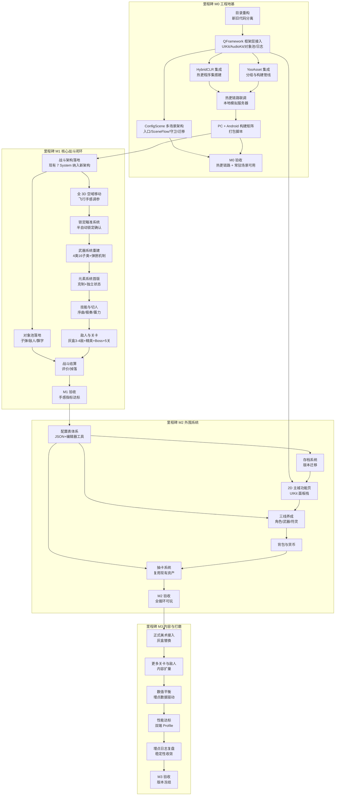

# 里程碑规划与任务依赖

> 本文档定义开发节奏（决策 D04、D13）：不排硬性工期，只排任务依赖顺序。里程碑以"可验收状态"定义，完成即进入下一阶段。开发时间不定，每个里程碑内部按依赖序推进，可随时暂停恢复。

## 里程碑总览

```
M0 工程地基 ──► M1 核心战斗闭环 ──► M2 外围系统 ──► M3 内容与打磨
   热更链路通         灰盒可玩              全循环可玩            正式资产+平衡
```

| 里程碑 | 验收状态 | 范围 |
|--------|----------|------|
| M0 | 热更链路全通 | 目录重构、QFramework 接入、HybridCLR + YooAsset 集成、PC + Android 构建、本地模拟热更演示 |
| M1 | 核心战斗灰盒可玩 | 全 3D 空战、锁定射击、切人、元素首版、敌人与关卡（精而少）、结算 |
| M2 | 全循环可玩 | 2D 主城、存档、配置表体系、三线养成、背包、货币、抽卡 |
| M3 | 内容与品质 | 正式美术接入、更多关卡、平衡调优、性能达标、埋点数据分析 |

## 任务依赖图



## 里程碑验收标准

### M0 工程地基

- [x] 新目录结构生效，旧 `02_Scripts/Before` 等目录完成隔离（暂留参考，不参与编译）
- [x] 编辑器运行模式从源码加载，不依赖 AB
- [x] PC 包与 Android 包均可启动，热更流程完整走通（版本比对 → 下载 → 加载新 DLL）
- [x] 修改一段热更代码 → 一键构建 → 真机运行显示新逻辑（热更闭环验证）
- [x] 日志与基础埋点框架可用
- [x] ConfigScene 多场景架构落地（见 `08_常驻管理场景_ConfigScene_设计.md`）：
  - [x] 新建 ConfigScene 入口 + GameRoot 骨架，Build Settings 置 [0]
  - [x] SceneFlow 场景切换控制器（请求对象 + 卸载旧场景 + active 管理 + LoadingGroup 遮罩）
  - [x] 懒加载守卫（运行时防重复 + 编辑器直接 Play 玩法场景自动加载 ConfigScene）
  - [x] 旧单例迁移（StoreBattleRoleData / BattleRoleRepository / LoadingGroup / UIRoot 入 ConfigScene，去 DontDestroyOnLoad）

### M1 核心战斗闭环

- [x] 全 3D 空域飞行手感达到玩法文档手感参数表（数值可调，机制稳定）
- [x] 锁定手感方案确认并实装（默认半自动）
- [x] 4 类武器全部可发射，弹匣/换弹/切人补弹生效
- [x] 4 元素状态效果生效，克制关系命中修正生效
- [x] 灰盒 5 关可完整游玩（清剿/护送/防守/Boss）
- [x] 结算评价与掉落正常，埋点完整落盘
- [x] 战斗内关键路径无每帧 GC 分配（Profile 验证）

### M2 外围系统

- [x] 存档创建/读取/迁移/备份可用
- [x] 配置表工具可编辑、校验、热更加载
- [x] 2D 主城功能页全入口可用
- [x] 三线养成闭环：关卡材料 → 升级 → 战力提升可见
- [x] 抽卡全流程：消耗 → 概率 → 结果 → 入背包 → 演出

### M3 内容与品质

- [x] 正式美术完成主要角色/武器/场景替换，灰盒仅剩占位元素
- [x] 关卡扩至 10+，敌人类型扩至 6+（含新增精英/Boss）
- [x] 双端帧率达标（性能文档目标值）
- [x] 埋点数据支撑至少一轮完整数值调整复盘

## 风险清单

| 风险 | 等级 | 缓解 |
|------|------|------|
| 热更链路集成踩坑（HybridCLR 与 Unity 版本兼容、AOT 泛型） | 高 | M0 独立验证，不与其他工作并行；补元数据纪律 |
| 3D 空战手感难调（移动端双摇杆 + 6 向飞行） | 高 | PC 先行，手感指标锁死；移动端输入抽象从 M1 就留接口 |
| 单人内容量失控 | 中 | D10 精而少策略 + M3 才扩量；参考原版"反复推倒"教训 |
| 移动端性能不达标 | 中 | 对象池进 M1、渲染分级进 M1、每版本真机 Profile |
| 旧资产版权风险 | 中 | 灰盒策略 + 资源层与代码层分离，替换不动代码 |
| 配置表与代码字段失同步 | 中 | 编辑器校验在构建期阻断 + 热更配置可即时修正 |

## 阶段推进规则

- 每个里程碑结束必须通过验收标准才进入下一阶段；未达标则留在当前阶段补任务
- M1 是整条时间线的重心：战斗手感是重制项目的灵魂，M2/M3 的一切都建立在 M1 可玩之上
- 时间不定背景下，建议开发顺序严格遵循依赖图：宁可慢，不跳依赖（跳依赖的返工成本高于等待成本）
