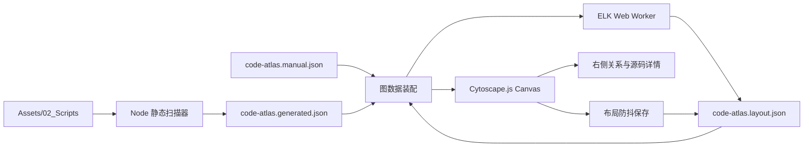

# 代码知识图谱可视化工具 · 设计与实施计划

> 日期：2026-09-19  
> 状态：K0–K5 已实施完成，K6 文档同步中（2026-09-19）  
> 工具目录：`web/ProgressChaser/`  
> 目标代码范围：`Assets/02_Scripts`；第三方框架作为外部边界，按需展开  
> 关联文档：`17_代码现状地图.md`、`18_Battle调用链与阅读目录.md`、`19_表现层分层_View与Actor_设计.md`

---

## 0. 背景与结论

项目代码已经按领域拆成 9 个程序集，但阅读困难已从“单个类看不懂”转为“能读懂类，却追不清调用链、事件和数据流”。现有文档能提供稳定的阅读路线，仍不能替代一个可交互、可更新的代码关系画布。

当前 `web/ProgressChaser` 已有一版原生 SVG 原型：能扫描 `Assets/02_Scripts`、生成程序集/类型关系、显示两层画布并把布局写入 JSON。实测代码规模约为 144 个 C# 文件、220 余个合并后类型、1,400 余条静态候选关系；进入 `TeaGame.Battle` 后，单图可能同时出现约 150 个节点和 400 组关系。原型在这个密度下暴露了两个问题：

1. 简单分列布局不能有效减少交叉、回边与长边，视觉上形成线团；
2. SVG 为节点和关系创建大量 DOM，拖拽时重建整图，元素过多后明显卡顿。

经需求确认与公开方案调研，目标方案定为：

- **Cytoscape.js**：负责 Canvas 图渲染、缩放、平移、拖拽、选择、筛选与邻居高亮；
- **ELK.js**：负责方向图的分层布局、端口与正交边路由；
- **Web Worker**：承载耗时布局计算，避免阻塞页面交互；
- **JSON**：继续作为扫描结果、人工知识和布局状态的可审查来源；
- **Node.js 本地服务**：继续提供扫描、JSON 读写与源码片段接口；
- **一条命令启动**：允许 npm 依赖，用户只需双击 `.cmd` 或执行一个 `.ps1`。

本方案不要求继续维持“零依赖”。依赖只在首次安装或锁文件变化时安装；日常使用仍是一键启动。

---

## 1. 用户目标与已确认决策

### 1.1 使用目标

工具首先服务于“沿关系读代码”，而不是替代 IDE，也不是生成精确到运行时的全语义调用图。它应回答：

- 我应该从哪个程序集或类开始读？
- 一个类依赖哪些项目内类型和外部边界？
- 两个类之间为什么有连线？证据在哪个文件、哪一行、哪个方法？
- 某个事件由谁发布、谁订阅？
- 某份状态由谁读取、写入或绑定？
- 代码更新后，如何重新扫描而不丢失人工注释和手工布局？

### 1.2 两层画布

#### 第一层：程序集关系图

- 只显示程序集节点和 `.asmdef` 的引用方向；
- 项目内程序集与第三方/包程序集采用不同样式；
- 点击项目内程序集进入第二层；
- `TeaGame.App` 的 AOT 边界需要显著标识，便于发现错误的 AOT → 热更新引用；
- 面包屑保留“全部程序集 / 当前程序集”。

#### 第二层：程序集内部类图

- 显示当前程序集内的类型；
- 同时显示这些类型实际指向的外部类型或外部程序集边界；
- 外部节点默认可折叠或关闭，避免一进入 Battle 就铺满画布；
- 点击类节点高亮一跳邻居；
- 点击关系边，在右侧面板展开方法调用、事件、数据与状态读写证据；
- 不增加第三层方法画布。方法级内容进入关系详情，以保持类图可读。

### 1.3 关系类型

| 类型 | 含义 | 默认画布显示 | 详情内容 |
|---|---|---:|---|
| `assembly` | `.asmdef` 显式引用 | 是 | asmdef 路径、引用来源 |
| `class` | 类型字段、参数、创建或类型名引用 | 是，按节点对聚合 | 文件、行号、静态推断说明 |
| `call` | 可解析的方法调用候选 | 按需开启 | 调用方方法、目标成员、源码证据 |
| `event` | 事件发布与订阅 | 按需开启 | 发布/订阅角色、事件类型、源码证据 |
| `data` | 状态读取、写入或绑定 | 按需开启 | `read/write/subscribe`、成员链、源码证据 |

同一方向的两个节点之间只绘制一条聚合边。边上的计数代表明细数量；颜色用于表达当前主要关系类型。所有具体证据放入右侧面板，不用多条平行线重复绘制。

### 1.4 已确认交互

- 滚轮围绕鼠标位置缩放，范围 10%–400%；
- 拖拽空白区域平移画布；
- 拖拽节点后自动保存坐标；
- 支持自动布局、撤销、重置和适应画布；
- 支持关系类型筛选；
- 同一页面切换两层图并保留面包屑；
- 人工关系只编辑 JSON，不在网页内增加关系编辑器；
- 自动关系、人工关系和布局分文件保存；
- 代码中已删除的节点保留为孤立节点，由用户决定是否清理。

---

## 2. 公开方案调研与选型依据

### 2.1 ELK.js

来源：[kieler/elkjs](https://github.com/kieler/elkjs)、[Eclipse ELK](https://eclipse.dev/elk/)。

ELK 的 `layered` 算法适合具有明确方向的 node-link 图，支持端口、分层、交叉减少与边路由。官方同时提供浏览器 Worker 用法，适合把可能耗时的布局计算移出 UI 主线程。

本项目采用它解决：

- 程序集依赖从左到右的分层；
- 类关系的循环破除、层分配与交叉减少；
- 正交折线及边段坐标；
- 节点与层间距；
- 后续增量布局和固定节点约束。

ELK 只负责计算位置和边段，不负责渲染与交互。

### 2.2 Cytoscape.js

来源：[Cytoscape.js 官方文档](https://js.cytoscape.org/)。

Cytoscape.js 是面向图分析和可视化的纯 JavaScript 图引擎，使用 Canvas 渲染，支持 JSON 数据、布局扩展、桌面/触屏手势、过滤、选择、批量更新和图算法。其交互模型与本工具的缩放、平移、拖拽、邻居高亮、关系筛选高度吻合。

本项目采用它解决：

- 减少 SVG DOM 元素数量；
- 由成熟引擎管理缩放、平移、选择和拖拽；
- 使用 collection/selectors 高效筛选关系；
- 批量更新样式，避免每次交互重建整图；
- 使用 Canvas 统一绘制节点、边、箭头和标签；
- 保留 `preset` 布局以载入 JSON 中的人工坐标。

官方提供的 `hideEdgesOnViewport`、`textureOnViewport` 等提示可用于大图交互，但这些选项应通过实测决定，不因为存在就全部开启。

### 2.3 Sigma.js

来源：[Sigma.js 官方网站](https://www.sigmajs.org/)。

Sigma.js 使用 WebGL，面向数千节点和边的网络图，规模上限高于 SVG/Canvas。它适合宏观网络探索，但复杂节点外观、正交工程图边和关系详情定制成本更高。

因此 Sigma.js 不作为首版渲染器。若未来出现单视图超过约 1,000 节点或 5,000 聚合边、Cytoscape.js 经降级策略后仍无法达到交互指标，再启动 WebGL 渲染器评估；不要在当前规模下提前引入双渲染架构。

### 2.4 不采用 React Flow 的原因

React Flow 更适合需要创建、连接和编辑节点的流程编辑器。本工具主要是读取自动生成的关系，不需要在画布内创建边；引入 React 和应用构建链会扩大迁移面，且不能直接解决大图的关系密度。故本阶段不采用。

---

## 3. 目标架构



### 3.1 职责边界

| 部件 | 职责 | 不负责 |
|---|---|---|
| 扫描器 | 读取 C#/asmdef，生成稳定 ID、关系候选与源码证据 | 精确 C# 语义、运行时动态调用 |
| 图数据装配 | 合并自动关系、人工关系、孤立节点和筛选条件 | 布局计算和绘制 |
| ELK Worker | 根据当前可见节点/边计算节点坐标和边段 | 持久化、交互和业务筛选 |
| Cytoscape.js | Canvas 渲染、视口、拖拽、点击、邻居高亮 | 扫描源码和决定业务关系 |
| 本地服务 | 提供 JSON/API、原子写入、保存冲突检查、源码片段 | 解释关系含义 |
| JSON 文件 | 保存可审查结果、人工知识与布局 | 执行代码扫描 |

### 3.2 依赖与构建

`web/ProgressChaser/package.json` 至少包含：

```json
{
  "private": true,
  "scripts": {
    "start": "node server.js",
    "scan": "node scripts/scan-code-atlas.js",
    "test": "node --test"
  },
  "dependencies": {
    "cytoscape": "<实施时锁定版本>",
    "cytoscape-elk": "<实施时锁定版本>",
    "elkjs": "<实施时锁定版本>"
  }
}
```

版本在实施时查询 npm 正式版并锁入 `package-lock.json`。不得使用 CDN；浏览器依赖必须由本地服务提供，离线启动不依赖网络。

首选原生 JavaScript，暂不引入 React、TypeScript 或大型打包器。若浏览器无法直接消费包内 UMD/ESM 文件，再采用轻量构建步骤；启动脚本仍只暴露一条命令。

---

## 4. JSON 数据契约

### 4.1 自动扫描：`data/code-atlas.generated.json`

该文件由扫描器整体重建，不允许手工维护。建议继续沿用当前 `schemaVersion: 2`，并确保关系有稳定 ID 与源码证据。

```json
{
  "schemaVersion": 2,
  "generatedAt": "2026-09-19T00:00:00.000Z",
  "stats": {
    "assemblies": 9,
    "files": 144,
    "classes": 223,
    "lines": 18010
  },
  "assemblies": [],
  "classes": [],
  "relations": [
    {
      "id": "stable-hash",
      "source": "TeaGame.Battle::TeaGame.BattleRoleSystem",
      "target": "TeaGame.Battle::TeaGame.BattleStateModel",
      "kind": "data",
      "label": "写入 Hud.CurrentRoleIndex.Value",
      "file": "Assets/02_Scripts/03_Battle/...cs",
      "line": 123,
      "method": "SelectRole",
      "access": "write",
      "confidence": "candidate"
    }
  ],
  "orphans": [],
  "diagnostics": {}
}
```

`confidence` 的含义：

- `declared`：来自 asmdef 等显式声明；
- `candidate`：词法静态分析得到的候选关系；
- `manual`：人工 JSON 补充的业务关系。

页面必须显示置信度，不能把静态候选称为完整、精确的 C# 调用图。

### 4.2 人工知识：`data/code-atlas.manual.json`

人工关系和注释只在这里维护。重新扫描不得覆盖该文件。

```json
{
  "schemaVersion": 1,
  "relations": [
    {
      "id": "manual-role-hud",
      "source": "TeaGame.Battle::TeaGame.BattleRoleSystem",
      "target": "TeaGame.Battle::TeaGame.BattleHudState",
      "kind": "data",
      "label": "角色切换时同步 HUD",
      "note": "用于理解角色选择、阵亡接管和 HUD 更新的业务链"
    }
  ],
  "notes": [
    {
      "node": "TeaGame.Battle::TeaGame.BattleRoleSystem",
      "text": "推荐先读 SelectRole，再读 HandleRoleDowned。"
    }
  ]
}
```

服务启动和“重新读取 JSON”时必须校验：schema、ID 唯一性、节点引用和 `kind` 合法性。错误需显示文件名和具体字段，不静默忽略。

### 4.3 布局：`data/code-atlas.layout.json`

```json
{
  "schemaVersion": 2,
  "revision": 12,
  "views": {
    "assembly": {
      "zoom": 1,
      "pan": { "x": 0, "y": 0 },
      "layout": "elk-layered",
      "direction": "RIGHT",
      "nodes": {
        "TeaGame.Battle": {
          "x": 640,
          "y": 240,
          "pinned": true,
          "color": "#5b8cff"
        }
      }
    },
    "class:TeaGame.Battle": {
      "zoom": 0.64,
      "pan": { "x": 120, "y": 80 },
      "layout": "elk-layered",
      "direction": "RIGHT",
      "nodes": {}
    }
  }
}
```

布局写入规则：

- 防抖保存，默认停止操作 600–1,000ms 后写入；
- 使用临时文件 + 原子替换；
- 携带 `revision/token`，拒绝覆盖其他页面或手工编辑产生的新版本；
- 保存失败时保留页面内脏状态并提供导出，不丢弃用户布局；
- 重新扫描只为新节点生成初始位置，已有稳定 ID 的位置继续保留；
- 失效节点标记为 `orphan`，不自动删除坐标和注释。

---

## 5. ELK 布局设计

### 5.1 程序集图

使用 `elk.layered`，方向 `RIGHT`。程序集图节点少，始终显示全部项目内程序集；第三方引用按边界分组或放在最右侧。

初始建议参数：

```js
{
  "elk.algorithm": "layered",
  "elk.direction": "RIGHT",
  "elk.edgeRouting": "ORTHOGONAL",
  "elk.layered.spacing.nodeNodeBetweenLayers": "90",
  "elk.spacing.nodeNode": "50",
  "elk.layered.crossingMinimization.strategy": "LAYER_SWEEP",
  "elk.layered.nodePlacement.strategy": "BRANDES_KOEPF"
}
```

具体参数以实际 9 程序集图验证结果为准。若正交边出现过多共线覆盖，可切换 `SPLINES` 比较，不把某个参数写成不可更改的规范。

### 5.2 类图

类图默认仍使用 `layered + ORTHOGONAL`，但进入布局前先做降噪：

1. 关系按 `source + target + direction` 聚合；
2. 默认使用 `class` 关系形成布局骨架；
3. `call/event/data` 作为聚合边详情，不全部参与层分配；
4. 只有用户开启相应关系后，才决定是否重新布局；
5. 外部节点先按程序集形成逻辑分组，再展开到具体类型；
6. 自环不交给 ELK 作为普通边，使用节点旁的自环标记；
7. 双向关系在详情中明确双方方向，画布上使用双向或两条分 lane 边。

### 5.3 边路由与视觉规则

- 边必须从节点端口出发，不穿过节点主体；
- 箭头方向固定为“引用者 → 被引用者”；
- 事件采用“发布者 → 事件类型 → 订阅者”的语义，不能把订阅边误画成事件类型调用订阅者；
- 正交边共用干线时，用选择高亮区分，不强行为每条关系分配巨大间距；
- 未选中状态下边使用低对比度；
- 选中节点后，只强调一跳邻居和相连边，其余元素降至 10%–20% 透明度；
- 边标签默认隐藏，只在选择或高缩放级别显示；
- 一条聚合边显示明细计数，不把每个方法调用画成独立边。

### 5.4 Worker 与取消

- ELK 必须运行在独立 Worker；
- 每次布局请求携带递增 `requestId`；
- 筛选变化或切换程序集时，旧结果即使返回也不得覆盖新视图；
- 大图布局超过 3 秒时显示进度状态和“取消布局”；
- 取消后保留上次有效布局，不清空画布；
- Worker 报错时回退到已保存坐标或简单网格布局，并显示错误。

---

## 6. 性能治理

### 6.1 主要瓶颈

现有 SVG 原型的卡顿不是单一原因：

- 节点和每种关系都对应 DOM；
- 拖动节点时整图 `replaceChildren`；
- 同一对节点的多种关系生成多条路径；
- 低缩放级别仍渲染完整标签和边；
- 主线程同时承担输入、布局和 DOM 创建；
- 一次性显示 150 节点、400 聚合边时，关系本身已经超出舒适阅读密度。

### 6.2 分级显示（LOD）

| 缩放范围 | 节点 | 边 | 标签 |
|---|---|---|---|
| 10%–30% | 简化色块/短名称 | 仅骨架关系 | 隐藏 |
| 30%–70% | 名称 + 类型 | 聚合边 | 仅节点名 |
| 70%–150% | 完整节点 | 选中边突出 | 节点名、边计数 |
| 150%–400% | 完整节点与状态 | 关系样式完整 | 按需显示边标签 |

LOD 只改变表现，不改变 JSON 数据与选择状态。

### 6.3 交互期间降级

- 缩放/平移期间暂停边标签和阴影；
- 大图下可临时隐藏未选中边，视口稳定后恢复；
- 节点拖拽只更新该节点和关联边，不重建图实例；
- 多项样式变化必须使用 Cytoscape batch；
- 搜索、筛选和邻居高亮使用 Cytoscape collection/selectors；
- 连续滚轮与拖拽事件通过浏览器帧节奏处理，不对每个原始事件写盘；
- 布局与扫描结果采用缓存键：`graph hash + filter set + layout options`。

### 6.4 关系密度控制

性能优化不能只靠渲染器。即使 60 FPS，400 条同时可见的交叉线仍不可读。类图默认策略：

- 默认开启 `class`；
- `call/event/data` 默认只作为边详情，可单独开启；
- 默认只展开当前程序集；
- 外部引用默认显示程序集聚合节点，点击后再展开具体外部类型；
- 支持“只看一跳 / 两跳邻居”；
- 支持按类型名、文件路径、namespace 搜索并定位；
- 支持“隐藏孤立节点”和“仅显示有关系节点”；
- 关系筛选不删除底层数据，只改变当前视图。

### 6.5 性能预算与测量口径

以当前 Battle 数据集作为验收基线，并增加合成大图测试：

| 场景 | 目标 |
|---|---|
| 首次进入程序集图 | 本地数据读取后 500ms 内可交互（不含首次 npm 安装） |
| 进入 Battle 类图 | 1 秒内出现可交互的旧布局；ELK 可继续后台优化 |
| 拖拽/平移/缩放 | 常态目标 50–60 FPS；P95 帧耗时不高于 32ms |
| 150 节点 / 400 聚合边 | 连续操作 10 秒无明显输入滞后，无长任务持续阻塞 |
| 500 节点 / 2,000 聚合边合成图 | 可完成缩放、平移、搜索和邻居高亮；允许自动降级标签/边 |
| ELK 布局 | 主线程不出现超过 100ms 的布局长任务；Worker 可取消 |
| 内存 | 连续切换 20 次程序集视图后无持续线性增长 |

测试时记录 Chrome Performance：FPS、Long Task、主线程时间、JS heap。不要只凭“感觉顺滑”宣布完成。

---

## 7. 页面结构与阅读流程

```text
┌──────────────────────────────────────────────────────────────────┐
│ 重新读取 JSON  重新扫描  自动布局  撤销  重置  适应画布  搜索 │
├────────────┬───────────────────────────────────────┬─────────────┤
│ 关系筛选   │ 面包屑：全部程序集 / TeaGame.Battle  │ 关系详情    │
│ 显示外部   │                                       │             │
│ 邻居深度   │        Cytoscape Canvas              │ 源/目标     │
│ 布局方向   │        缩放 / 平移 / 拖拽            │ 类型/置信度 │
│ 性能模式   │                                       │ 文件/行号   │
│ JSON 状态  │                                       │ 源码片段    │
└────────────┴───────────────────────────────────────┴─────────────┘
```

推荐阅读流程：

1. 在程序集图确认依赖方向和边界；
2. 点击程序集进入类图；
3. 搜索入口类，如 `BattleSceneRuntimeHost`；
4. 选择入口类，只看一跳邻居；
5. 点击聚合边，在右侧确认方法、事件或数据证据；
6. 点击外部类时，可进入其所属程序集类图；
7. 将确认后的业务含义补入 `code-atlas.manual.json`；
8. “重新读取 JSON”后人工说明立即显示。

---

## 8. 本地启动与离线要求

### 8.1 `.cmd`

`start-progress-web.cmd` 目标行为：

1. 切到脚本所在目录；
2. 检查 `node` 和 `npm` 是否可用；
3. 比较 `node_modules`、`package-lock.json` 与安装标记；
4. 缺依赖时执行 `npm ci`；无锁文件的首次开发期才允许 `npm install`；
5. 依赖完整时执行 `npm start`；
6. 服务启动后打开 `http://127.0.0.1:3210/code-atlas.html`；
7. 命令行窗口关闭时服务终止。

安装失败必须保留命令行窗口并打印可读错误，不能一闪而过。

### 8.2 PowerShell

同时提供：

```powershell
pwsh -ExecutionPolicy Bypass -File .\start-progress-web.ps1
```

支持参数：

```powershell
.\start-progress-web.ps1 -Port 3210 -NoOpen -SkipInstall
```

> 实施注记（2026-09-19）：按用户决定**不新增 `.ps1`**，只保留 `start-progress-web.cmd` 作为一键入口；依赖检查与安装委托给 `scripts/ensure-deps.js`。以下 PowerShell 方案保留为设计参考。

### 8.3 离线

- 完成一次依赖安装后，日常启动不访问网络；
- 前端不引用 CDN；
- `package-lock.json` 入库；
- `node_modules/` 不入库；
- 若锁文件改变，启动脚本提示并重新执行 `npm ci`；
- 不把 Unity 的 `Library/`、`Temp/` 或其他生成目录纳入扫描。

---

## 9. 分阶段实施

### K0：现状冻结与基准

**目的**：在替换渲染器前保留可比较证据。

- 备份当前三份 JSON；
- 固定一份 Battle 基准图统计：节点数、聚合边数、关系明细数；
- 记录现有 SVG 的首次渲染、拖拽和缩放性能；
- 把现有可用交互列为回归清单；
- 明确 `web/` → `web/ProgressChaser/` 的历史搬迁状态，避免把用户已有目录改动误算为本任务删除。

**退出条件**：基准数据和回归清单可重复取得。

### K1：依赖与启动链

- 新增 `package.json` / `package-lock.json`；
- 安装并锁定 Cytoscape.js、ELK.js、cytoscape-elk；
- 新增 `.ps1`，升级 `.cmd`；
- 保持进度面板接口和页面可用；
- 增加 `/api/health`，启动脚本可据此等待服务就绪再开浏览器。

**退出条件**：干净环境执行一条命令能安装、启动；第二次启动不重复安装；离线重启成功。

### K2：Cytoscape 渲染迁移

- 保持当前扫描器与 JSON 契约；
- 用 Cytoscape 替换 SVG DOM 渲染；
- 恢复两层视图、面包屑、筛选、拖拽、缩放、右侧详情和源码片段；
- 节点位置继续写入 layout JSON；
- 同向关系聚合成单边；
- 实现邻居高亮和外部节点样式。

**退出条件**：功能回归通过；Battle 图拖拽时不再重建全部节点/边 DOM；保存后刷新坐标不丢。

### K3：ELK Worker 布局

- 建立 Worker；
- 程序集图接入 layered；
- Battle 类图接入 layered + orthogonal；
- 保存 ELK 结果；
- 处理请求取消、过期结果和布局失败回退；
- 保留手工 pinned 节点；
- 对比至少两组 edge routing / crossing 参数，记录选择依据。

**退出条件**：线条穿节点、无意义长边和交叉数量明显下降；布局期间 UI 可继续缩放/平移；旧请求不会覆盖新图。

### K4：大图性能与渐进披露

- LOD；
- 交互期间降级；
- 一跳/两跳邻居模式；
- 外部程序集聚合；
- 搜索定位；
- batch 样式更新；
- 视图切换释放旧监听和引用；
- 运行当前图与合成大图性能测试。

**退出条件**：达到 §6.5 指标，或对未达项给出测量证据和明确降级阈值。

### K5：JSON 维护与错误恢复

- generated/manual/layout 完整 schema 校验；
- 人工 JSON 错误定位；
- orphan 管理；
- 布局 revision/token 冲突；
- 保存失败导出；
- generated 备份与扫描失败回滚；
- README 写清手工更新步骤和示例。

**退出条件**：错误 JSON 不破坏上次可用图；重新扫描不覆盖人工关系和已有布局。

### K6：收尾与文档同步

- 更新 `web/ProgressChaser/README.md`；
- 记录最终依赖、版本、性能数据与已知限制；
- 更新本文实施记录；
- 同步 `Docs/README.md`、09、99；
- 由用户按 §11 做页面视觉验收。

**退出条件**：启动、扫描、阅读、保存、重启、错误恢复完整闭环。

---

## 10. 测试方案

### 10.1 自动测试

- 扫描器：namespace、partial、嵌套类、注释/字符串遮罩、嵌套 asmdef；
- 模型：关系聚合、方向、人工关系、孤立节点、筛选；
- 布局适配：ELK 输入输出、固定节点、外部节点、循环、自环；
- API：路径白名单、JSON 校验、原子写入、revision 冲突；
- 启动：缺依赖、已有依赖、端口冲突、`-NoOpen`；
- 前端：程序集 → 类图、筛选、选边、拖拽、保存、刷新恢复。

### 10.2 性能测试

建立三份固定数据：

- `current-assembly`：9 个程序集；
- `current-battle`：当前 Battle 实际数据；
- `synthetic-large`：500 节点 / 2,000 聚合边。

每次渲染或布局架构变化后，至少重跑 `current-battle`。合成图只验证性能与降级路径，不作为业务关系正确性依据。

### 10.3 用户视觉验收

Codex 不替用户打开网站检查。用户启动后重点观察：

1. 程序集方向是否直观；
2. Battle 类图是否仍有大面积线团；
3. 自动布局后是否容易从入口沿左 → 右阅读；
4. 拖拽、滚轮与平移是否流畅；
5. 选中类后无关内容是否有效弱化；
6. 边详情是否足以解释“为什么相连”；
7. 重启后布局是否恢复；
8. 视觉样式是否需要进一步接近 IDE/蓝图编辑器。

---

## 11. 风险与回退

| 风险 | 处理 | 回退 |
|---|---|---|
| ELK 布局时间过长 | Worker、取消、缓存、减少参与布局的边 | 使用已有 JSON 坐标/网格布局 |
| Cytoscape 自定义表现受限 | 节点样式保持简洁，复杂信息放右侧 | 保留旧 SVG 页面为临时诊断页，完成迁移后再删除 |
| 静态扫描误报 | 显示 `candidate` 与源码证据，人工 JSON 修正含义 | 关闭对应关系类型 |
| 自动扫描覆盖人工知识 | 三文件隔离、禁止写 manual | 从 manual 备份恢复 |
| 节点 ID 因重命名变化 | orphan 保留，提供旧 ID → 新 ID 人工映射 | 手工迁移 note/layout |
| 两页面同时保存布局 | revision + token 冲突拒绝 | 导出当前布局后重新读取合并 |
| 依赖安装失败 | 锁版本、清晰日志、README 排错 | 使用已安装依赖或恢复上一锁文件 |
| 单图继续膨胀 | 邻居模式、外部聚合、LOD | 评估 Sigma.js WebGL 只读大图视图 |

切换到 Sigma.js 的触发条件：在 500/2,000 合成图上，Cytoscape 完成 §6 的降噪与交互降级后，仍持续无法满足 P95 32ms 的交互目标，且主要瓶颈确认在 Canvas 绘制而不是布局或数据装配。触发后另写专项，不在本任务内同时维护两套渲染器。

---

## 12. 本次不做

- 不把 QFramework 等第三方源码默认完整纳入类图；
- 不实现完整 C# 编译器级语义分析；
- 不承诺解析反射、动态派发、依赖注入运行时绑定和所有泛型重载；
- 不建立方法节点第三层画布；
- 不在网页中编辑人工关系；
- 不接入云端数据库、账号系统或多人同步；
- 不把图谱写回 Unity 场景、Prefab 或 `.asset`；
- 不因为工具重构修改 `Assets/02_Scripts` 业务代码。

---

## 13. 完成定义

满足以下条件才可把本专项标记为完成：

- 一条 `.cmd` 或 PowerShell 命令可完成依赖检查并启动本地工具；
- 无网络时，在依赖已安装的机器上可正常启动；
- 两层图、面包屑、筛选、搜索、右侧证据、拖拽和缩放可用；
- ELK Worker 能生成可读的分层/正交布局，失败时安全回退；
- 自动扫描、人工知识和布局三份 JSON 互不覆盖；
- 重新扫描保留布局、人工注释和孤立节点；
- Battle 实际图与合成大图完成性能取证；
- 当前 SVG 原型暴露的线团和交互卡顿得到可感知改善；
- 自动测试通过，用户完成视觉验收；
- README、本文、Docs 索引、会话交接和下一步清单同步。

---

## 14. 当前实施记录

截至 2026-09-19：

- 已完成需求澄清：两层视图、关系类型、JSON 维护、交互与缩放范围；
- 已完成原生 SVG 原型和静态扫描器的第一版落地；
- 已生成 `generated/layout/manual` 三类 JSON，并具备布局保存与源码片段接口；
- 已确认原型在 Battle 大图下存在连线质量和性能问题；
- 已完成 ELK.js、Cytoscape.js、Sigma.js 公开资料调研；
- 已确认不坚持零依赖，只要求本地一条 `.cmd` 或 PowerShell 命令启动；
- **尚未安装 Cytoscape.js / ELK.js，尚未开始 K0–K6 的正式迁移；**（已于 2026-09-19 完成，见下）
- 当前工具与 JSON 均处于未提交工作区，实施前必须先核对 `web/` 历史目录搬迁，禁止用清理命令误删用户文件。

### 14.1 K0–K6 实施结果（2026-09-19 落地）

| 阶段 | 状态 | 落地内容 | 验证方式 |
|---|---|---|---|
| K0 | 完成 | `scripts/baseline-stats.js`：备份三份 JSON 并统计图规模 | 基准：9 程序集 / 143 文件 / 221 类型 / 1525 关系；Battle 151 节点 / 559 聚合边 |
| K1 | 完成 | `package.json` + `package-lock.json`（cytoscape 3.34.3 / cytoscape-elk 2.3.0 / elkjs 0.12.0）；`scripts/ensure-deps.js`；升级 `start-progress-web.cmd`（检查 node/npm → 按需 `npm ci` → 启动）；`GET /api/health`；`/vendor/*` 白名单静态资源 | 冒烟脚本；二次启动跳过安装 |
| K2 | 完成 | Cytoscape Canvas 替换 SVG DOM：两层视图、面包屑、筛选、拖拽、缩放、右侧证据与源码片段、同向关系聚合单边、邻居高亮、外部/孤立节点样式；节点坐标继续写 layout JSON | `atlas-view.test.js`；布局读写闭环 `scripts/verify-layout-roundtrip.js` |
| K3 | 完成 | `public/elk-worker.js`（`importScripts` + `elk.layout`）；主线程 `requestId` 丢弃过期结果、>3 秒显示取消、取消即 `terminate` 重建、失败回退扩展布局或网格 | headless ELK 测试；合成大图 500/2000 测得 ELK 约 5.7s，验证取消路径 |
| K4 | 完成 | LOD（10–30/30–70/70–150/150–400）；`cy.batch()` 批量样式；闭邻域高亮；一跳/两跳邻居；搜索定位；视图切换销毁重建 Cytoscape 实例；`scripts/perf-atlas.js` | 合成大图数据管线耗时见 `web/ProgressChaser/PERFORMANCE.md` |
| K5 | 完成 | `validateGenerated` / `validateManual` / `validateLayout`（逐字段定位错误）；layout 兼容 schemaVersion 1/2 并提升为 2；orphan 标记与保留；`revision` + `token` 冲突返回 409、校验失败返回 400；扫描先入内存、失败不动旧文件、成功前写 `.bak` | `atlas-schema.test.js`；闭环脚本验证冲突拒绝 |
| K6 | 进行中 | 重写 `web/ProgressChaser/README.md`；新增 `PERFORMANCE.md`；同步本文 | 待用户按 §10.3 做页面视觉验收 |

**测试现状**：`npm test` 共 10 项通过（扫描器 3、图装配/渲染 4、JSON 契约 3）。
**数据迁移**：`data/code-atlas.layout.json` 已由 `schemaVersion 1 / revision 39` 迁移为 `schemaVersion 2`（坐标与 revision 保留）。
**未完成**：浏览器帧率 / 内存 / 视觉验收（需真人在浏览器中按 §10.3 / §6.5 取证）。

